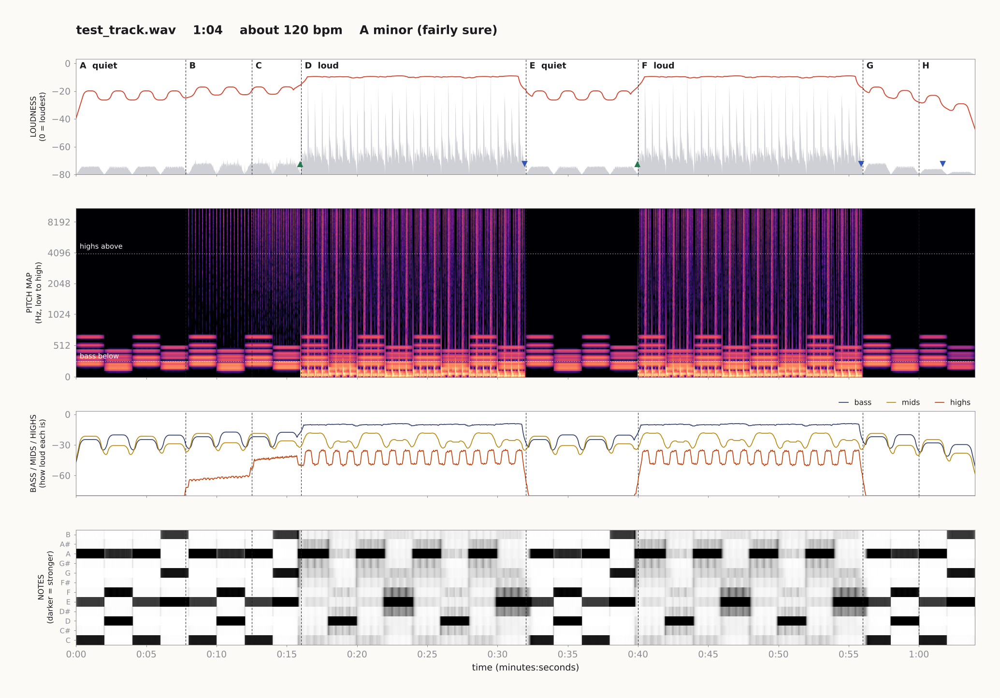

# If Claude had ears

**Lets an AI that cannot hear read sound instead: music, words, films and YouTube.**

AI assistants like Claude work with text and pictures. They have no ears. But sound can be turned into pictures and numbers, the same way a musician can look at a score in silence and know how the music goes.

`ears` is a small tool and a Claude skill that does this. With it, Claude can:

- **Read music.** Tempo, key, chords, where the beat falls, where the track builds and drops, and what kind of rhythm it has (waltz, swing, backbeat, four-on-the-floor, half-time).
- **Read words.** What is said in a voiceover, interview or film, in many languages, with the times, plus how high the voice is, how fast it talks and where it pauses.
- **Read a film's sound against its picture.** Every picture cut, and whether it lands on the beat. Loudness measured the way broadcasters and streaming services measure it.
- **Listen to YouTube.** Read the sound of a YouTube tab (or other web page) while it plays, and fetch YouTube's own transcript, with no file needed.

It is reading, not hearing. It gives an AI the structure, timing and energy of a track. It does not give it the feeling.



## What you get

Run it on `song.mp3` and you get a folder called `song_ears` with:

| File | What it is |
|---|---|
| `report.md` | The track in plain words: length, tempo, key, style clues, sections, chord changes, the moments where sound kicks in or drops out, and the time of every beat |
| `overview.png` | The whole track in one picture |
| `zoom_01...png` | The same picture, close up, 20 seconds at a time |
| `data.json` | Every number behind the report, for other tools to use |

## How to use it

You need Python 3.9 or newer and [ffmpeg](https://ffmpeg.org) (ffmpeg is what lets it open mp3, mp4, mov and almost anything else).

```
pip install -r requirements.txt
python ears.py song.mp3
```

It works on video files too. It just reads the sound track:

```
python ears.py film.mp4
```

To also write down what is said and describe the voice, add `--words`. This needs one extra install, and fetches a speech model (about 150 MB) the first time:

```
pip install sherpa-onnx
python ears.py interview.mp4 --words
```

It works out the language by itself. If you know the language, say so, which is steadier when the voice is over music: `--words-language ms` for Malay, `en` for English, `zh` for Chinese, and so on. `--words-model small` is more accurate and slower; `tiny.en` is a quick English-only one.

Other options: `--out folder` chooses where the results go, and `--zoom 10` makes each close-up cover 10 seconds instead of 20.

## How to read the picture

Time runs left to right in all four rows.

1. **Loudness.** The grey shape is the raw sound wave. The red line is how loud it is, where 0 is the loudest moment of the track. Dashed lines mark where the track changes, and each stretch gets a letter. Green triangles mark sound kicking in, blue triangles mark sound dropping out. In close-ups, small ticks along the bottom are the beats.
2. **Pitch map.** Low sounds at the bottom, high sounds at the top, brighter means stronger. A kick drum is a bright blob at the very bottom. A cymbal is a thin stripe reaching the top. A held note is a horizontal line.
3. **Bass / mids / highs.** Three lines showing how loud the low, middle and high parts of the sound each are. When the bass line jumps up, the bass has come in.
4. **Notes.** Which of the twelve notes are sounding. A chord shows up as three or four dark bars at the same time.

There is a longer guide in [HOW_TO_READ.md](HOW_TO_READ.md).

## Style clues: reading what kind of music it is

The report has a "Style clues" section that describes how the music is built:

- **Count:** in three (waltz, 6/8) or in four.
- **Between the beats:** straight, swung (the long-short lilt of jazz and blues), or split in threes.
- **Low hits:** a kick or bass note on every beat, on half of them, or sparse.
- **Bright hits:** a snare or clap on every second beat (a backbeat), on every fourth (half-time, as in trap), or no drum kit at all.
- **Chords:** the likely main chords and how often they change.
- **Deep bass** and **loud-to-quiet range.**

From those it gives a shortlist of the kinds of music that usually have that rhythm, with the reason for each. It is a shortlist, not a verdict: rhythm narrows the field, but instruments and vocals decide the genre, and ears cannot name those.

[MUSIC.md](MUSIC.md) is the field guide behind this. It explains what separates one genre from another, what about 30 genres look like in a report, and how to reason from clues to a style.

## For films and adverts

Give it a video file and the report also has:

- **Picture cuts against the music:** the time of every cut, the nearest beat or half-beat, and how far off it is. In the pictures, each cut is a small blue mark.
- **Loudness for delivery:** the overall loudness in LUFS and the true peak, which is what a broadcaster or platform will check.

## Words and voice

With `--words`, the report gains two sections.

- **Words:** what is said, line by line with start and end times, read by an open speech model (Whisper).
- **Voice and speech:** how high the voice is, how much its pitch moves, the pace in words a minute, and every pause with its time (the natural places to cut a voiceover).

[SPEECH.md](SPEECH.md) is the guide behind this: what speech sounds look like as a picture, why words cannot simply be read off it, and what to expect from the speech model.

## Only have a link, not a file?

[live/](live/) holds a script that reads the sound of a browser tab while it plays, silently, without saving any audio. An AI assistant with a browser tool can use it to read tempo, key and loudness shape from a YouTube or other page, and to fetch YouTube's own transcript. It gives less detail than the file version. See [live/README.md](live/README.md).

## How accurate is it

Tested on a small set, so treat these as a first check, not a guarantee.

**Five made-up tracks where the right answers are known** (same layout at 90, 120, 128, 140 and 174 beats per minute, all in A minor; `examples/make_test_track.py` builds them):

| What | Result |
|---|---|
| Tempo | Within 0.5 bpm on four tracks. The 174 track was read as 87, exactly half. This double-or-half mix-up is common, so the report always lists both |
| Key | Correct on all five |
| Big changes (beat comes in, breakdown, beat returns, fade) | All found, within 0.6 seconds |
| Small change (quiet hi-hats starting) | Found on four, misplaced on one |
| Beat positions | Typically within 1/100 of a second where drums are playing |

**Three real recordings** (from the open example set that comes with the librosa library):

| Recording | Result |
|---|---|
| A drum and bass loop | 137 bpm, strong steady beat |
| Tchaikovsky, Dance of the Sugar Plum Fairy | E minor, which is the key it is written in. Clear beat, about 109 bpm |
| A spoken audiobook clip | Correctly reported "no steady beat" |

**Style clues, on eight made-up rhythm tracks with known answers** (`examples/make_pattern_tracks.py` builds them):

| Track | What it really is | What ears read |
|---|---|---|
| house | 124 bpm, kick on every beat, clap on 2 and 4 | All correct. Shortlist: house, dance-pop or disco |
| backbeat | 110 bpm, kick and snare taking turns | All correct. Shortlist: pop, rock, funk or country |
| shuffle | 96 bpm, swung, backbeat | All correct. Shortlist: blues shuffle first |
| waltz | 150 bpm, in three | All correct. Shortlist: waltz |
| trap | 140 bpm, snare every fourth beat, deep bass, one chord | All correct. Shortlist: trap or drill |
| swing | 150 bpm, swung, walking bass | Swing found, but tempo read as 75 (half) and one of three chords wrong. Shortlist has swing jazz second |
| six8 | 60 bpm, each beat split in three | Read as 90 bpm "in three". The right family, the wrong way of counting it |
| nodrums | 80 bpm, slow chords only | "No steady beat" (the chords are too far apart to count as a beat). Shortlist: free-tempo music |

Main chords were right on six of the eight, wrong on one (swing), and not read on one (nodrums, because chords are read beat by beat and no beat was found). Major or minor was right on six; the two tracks built on A minor, F, C, G were read as C major, which is the closely related key that uses the same notes.

**Style clues, on real recordings.** I can only check these against what their titles say, since nobody here can listen:

| Recording | Result |
|---|---|
| "Sweet Waltz" | Read as "in three". Shortlist: waltz |
| Tchaikovsky, Sugar Plum Fairy | No drum kit, in four or two, E minor. Shortlist: classical or acoustic |
| Brahms, Hungarian Dance no. 5 | "No steady beat" (the players push and pull the tempo), no drum kit. Shortlist: free-tempo classical |
| "Pistachio Ice Cream Ragtime" (piano) | Steady, straight, no drum kit. Shortlist: acoustic or classical piano |
| Drum and bass-guitar loop | Drum-like hits, backbeat |
| "Vibe Ace" (a jazz-flavoured piece) | Backbeat at 130. Shortlist said pop, rock, funk or country, which misses the jazz. This is the limit: without swing, rhythm alone cannot see jazz |
| Spoken audiobook clip | No beat. Shortlist includes "not music at all: speech" |

There are no real trap, house, rock or metal recordings in this test set, so those shortlists are only proven on the made-up tracks.

**Words, on three audiobook clips** (about 15 seconds each, from the same open example set):

| Clip | Result |
|---|---|
| Jane Austen, *Northanger Abbey* (checked against the book's text) | 44 of 46 words right. "Catherine" came out as "Chather in" and "Go" as "Girl" |
| Bulfinch, *The Age of Chivalry* (checked against the book's text) | Most words right. "knights" came out as "nights" (same sound), "Guenever" was misspelled, and "a-maying into" became "a mane to" |
| A detective story | Reads as a sensible sentence; the Scottish place names are clearly wrong. No text to check against |

Voice pitch was read as about 225 Hz for the reader with a woman's name and 145 and 80 Hz for the two with men's names, which fits. Pauses were found between sentences. On the music test track, it correctly reported "no clear speech found".

The three results above are from the small English-only model (`tiny.en`). A three-minute speech file took about 40 seconds in total.

**Words in another language, over music.** A 30-second advert with a Malay voiceover running over music, read with the default multi-language model:

| What | Result |
|---|---|
| Language | Recognised as Malay without being told |
| The voiceover | Read as fluent Malay sentences that fit the advert. A few words in the middle are clearly garbled. Not yet checked against the script |
| A false word | The model "read" a one-word line into a sound effect near the start. ears now drops any line that has no voice in it, and says that it did |
| Steadiness | Reading the same voiceover from a slightly different starting point once returned only "[music]". A voice over music is read less reliably than clean speech |

On the two English audiobook clips the multi-language model did slightly worse than the English-only one.

**Picture cuts and loudness**, on the same advert: ten cuts found, which matched the shot changes visible in a frame-by-frame contact sheet. Seven were within 0.05 seconds of a beat or half-beat. Fades were not tested.

**Live listening in a browser tab** ([live/](live/)): on the test track it read 119.75 bpm (true 120) and A minor (correct), with the right loudness shape. It also collected sound from a YouTube video. Not tested on SoundCloud or Spotify.

## What it cannot do

- It cannot tell you if a track is good, or how it feels.
- It does not name instruments. It can say "bright hits" but not "that is a tambourine".
- Words come from a speech model and will have mistakes, above all in names and in words that sound alike. It does not judge tone of voice or emotion, and it does not say who is speaking.
- Tempo can come out as double or half the real speed. Key can be confused with a close relative (C major and A minor use the same notes).
- Chords are matched to plain major and minor only. Richer chords show as their nearest plain chord.
- The style shortlist goes by rhythm. It cannot tell rock from pop from country, or see that a piece is jazz unless it swings.
- Where there are no drums, beat positions are estimated and can drift.
- Section letters (A, B, C) are labels in order. They do not mean verse or chorus.

## Using it with Claude

The skill is in [skills/ears/](skills/ears/SKILL.md). It is a short instruction sheet that tells Claude when to use this tool and how to talk about what it finds.

- **Claude app:** add the `skills/ears` folder as a skill.
- **Claude Code:** the repo is laid out as a plugin. `/plugin marketplace add jvhz/if-claude-had-ears` and then `/plugin install ears@if-claude-had-ears` should install it. This install route has not been tested yet.
- **Or no install at all:** tell Claude "use the tool at github.com/jvhz/if-claude-had-ears on this file and tell me what you find".

## How it works

One Python file, `ears.py`, plus one browser script, `live/ears_live.js`. `ears.py` is built on [librosa](https://librosa.org) (sound analysis) and [matplotlib](https://matplotlib.org) (drawing). The code is commented in plain language.

## Licence

MIT. See [LICENSE](LICENSE).
